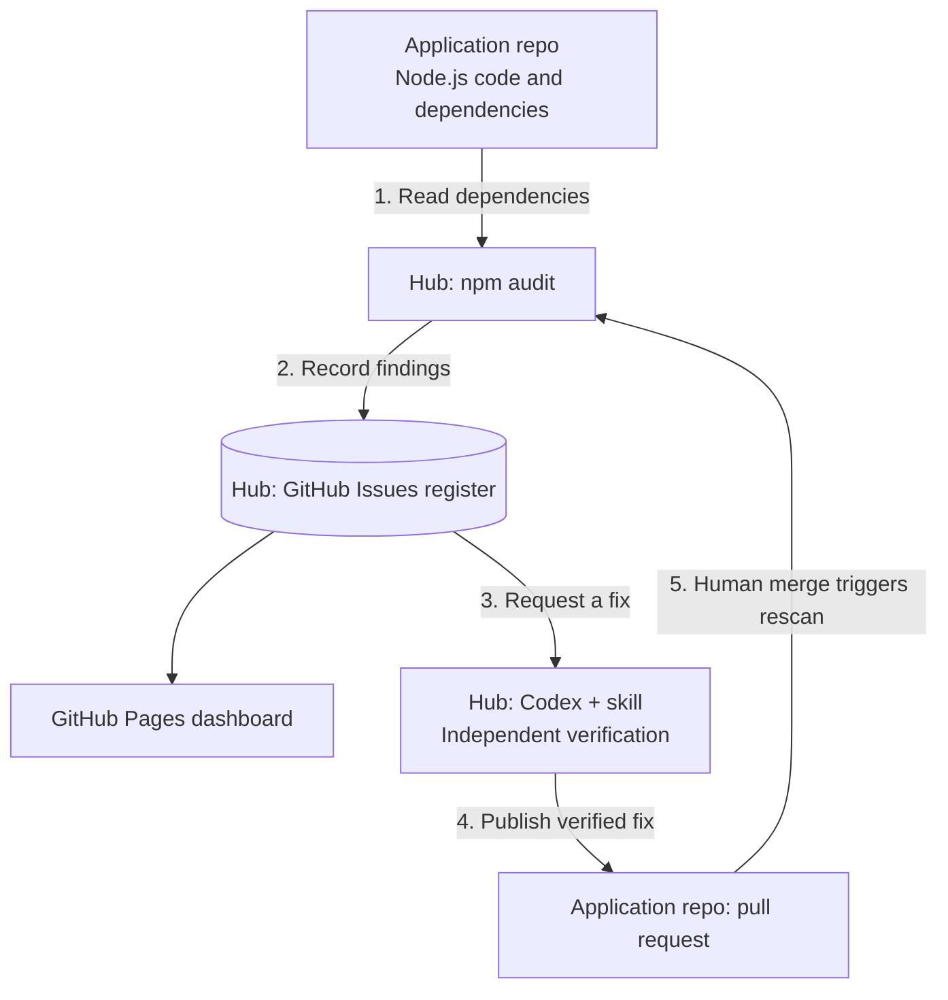

# Vulnerability Hub

A working demo of a central repository that finds dependency vulnerabilities in another repository, records them, and uses Codex to propose verified fixes.

[Live dashboard](https://vc4u2c.github.io/github-action-codex/) | [Vulnerability register](https://github.com/vc4u2c/github-action-codex/issues?q=label%3Avulnerability-register) | [Application repository](https://github.com/vc4u2c/vulnerable-node-demo)

## Start here

| Guide | What it explains |
| --- | --- |
| [Architecture](docs/architecture.md) | The two repositories, simple Mermaid diagrams, and the two GitHub Apps |
| [Setup](docs/setup.md) | How to reproduce the installation, with commands and checkpoints |
| [Implementation](docs/implementation-guide.md) | What was built, how the code works, credentials, and verified run evidence |
| [Demo runbook](docs/demo-runbook.md) | How to scan, fix, merge, verify closure, and reset for another demo |
| [Adversarial review](docs/adversarial-review.md) | Reproduced verification gaps, fixes, regression checks, and remaining limits |

## How it works



**A merge does not close a finding by itself.** A successful scan of the application's default branch must confirm the advisory is gone.

The hub owns the workflows, GitHub Issues register, dashboard, and remediation skill. The application repository owns the code, tests, and pull requests. Codex runs on a temporary GitHub Actions runner and uses the OpenAI API; it does not run inside the dashboard.

## Request a fix

On the [dashboard](https://vc4u2c.github.io/github-action-codex/), choose **Request fix**, then tick **Request a Codex fix** on the finding's GitHub issue. You need write access to the hub. The workflow checks authorization, runs Codex and independent verification, and opens a PR for review. Findings that already have an open fix show **Review PR**.

## Try the local rehearsal

Install Git and Node.js 22 or newer. Keep both repositories beside each other:

```text
Repos/
  github-action-codex/
  vulnerable-node-demo/
```

From `github-action-codex`:

```sh
npm test
npm run demo:reset
npm run dashboard
```

Open **http://127.0.0.1:4173**. In a second terminal in the hub, run `npm run demo:fix`, refresh the page, then run `npm run demo:reset` to reopen the finding. On Windows PowerShell, use `npm.cmd` if `npm.ps1` is blocked.

This rehearsal uses a real npm audit and a scripted dependency update in `.work/demo-target`. It does not call OpenAI or create GitHub issues/PRs. The [GitHub runbook](docs/demo-runbook.md) demonstrates the real Codex workflow.

## Scope

The implementation scans known npm dependency advisories. It supports multiple configured repositories under one GitHub App installation owner. Cloud resources, containers, application-code scanning, and automatic merging are outside the current implementation.

The application is intentionally vulnerable and runs locally. Publishing its source does not require deploying the application. See the [implementation guide](docs/implementation-guide.md#supported-scope-and-extension-points) before adapting the demo to other applications.
