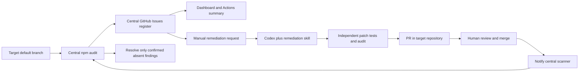

# Vulnerability Hub

A two-repository demonstration of centralized dependency scanning and Codex-assisted remediation.

- **This repository:** scanner, GitHub Issues register, dashboard, remediation skill, and orchestration.
- **[vulnerable-node-demo](https://github.com/vc4u2c/vulnerable-node-demo):** the application, its tests, and remediation PRs. This link becomes available after publishing the companion repository.

The hub uses Node.js built-ins; it has no application dependencies. The dashboard is static HTML/CSS/JavaScript generated from the register.



## Try it locally

Keep the two repositories as sibling directories. Install Node.js 22 or newer.

```text
Repos/
  github-action-codex/
  vulnerable-node-demo/
```

From the target repository:

```sh
npm ci --ignore-scripts --no-audit --no-fund
npm test
npm start
```

The app listens on http://127.0.0.1:3000. Try /health and /api/products?sort=price. It deliberately pins vulnerable dependencies and is intended for local demonstrations.

From this repository:

```sh
npm test
npm run demo
npm run dashboard
```

Open **http://127.0.0.1:4173**. The local demo performs a real registry audit; it does not create GitHub Issues or call OpenAI. It persists local history in artifacts/local-register.json. The dashboard shows severity, repository, lifecycle status, dates, and PR/issue links when GitHub data is available.

On Windows PowerShell, use **npm.cmd** if npm.ps1 is blocked by your execution policy.

To exercise the fix gate and open → resolved → reopened lifecycle in an isolated copy:

```sh
node scripts/verify-demo.mjs
```

This upgrades minimist only in an ignored temporary workspace, runs the same verification script used in CI, and saves evidence to artifacts/integration-verification.json. The original demo remains vulnerable.

## GitHub setup

Follow **[docs/setup.md](docs/setup.md)** to publish both repositories, configure GitHub App credentials, enable the dashboard, and run the demo. The configured owner is vc4u2c; change it with:

```sh
npm run configure -- YOUR_OWNER
```

| Workflow | Trigger | Result |
| --- | --- | --- |
| Scan and reconcile register | Manual, every six hours, or dispatched after a target default-branch push | Audits allowlisted targets, updates central issues, exports evidence and dashboard |
| Remediate vulnerability | Manual; supply a central issue number | Fresh scan → Codex proposal → independent tests/audit → target PR |
| Hub CI | Push/PR | Runs register, audit, API, and patch-gate tests |
| Application CI (target repo) | Push/PR | Tests the app; a separate job notifies the hub after a default-branch push |

For the walkthrough: run **Scan and reconcile register**, choose an issue with a fix, run **Remediate vulnerability** with that issue number, review its target PR, and merge it. The target's notifier requests a rescan. The selected issue closes only after successful verification on the default branch.

## Finding identity and lifecycle

A finding is identified by repository + lockfile path + package + advisory ID. Dependency version and severity do not change its identity.

**open → pr-open → resolved** is the usual lifecycle. Merged PRs whose scan is unavailable can show **awaiting-verification**. A merged PR that still leaves the advisory present returns to **open**. A later recurrence reopens the same issue. Closing a PR without merging does not resolve a finding.

Each issue stores structured metadata in a hidden marker plus a readable table. Issues are the GitHub source of truth; exported JSON and the dashboard are snapshots. Put human notes in issue comments because scans own the issue body. Avoid manually closing managed issues: the next scan reopens them if still present.

Scans read package.json and package-lock.json at one exact default-branch commit. They audit these files in a temporary directory without installing or executing target code. Invalid reports, registry failures, and default-branch movement are scan failures, never clean results. A failed target retains previous findings, and its failure appears in the dashboard. Successfully scanned targets can still reconcile independently.

## Remediation boundaries

The skill is [.agents/skills/remediate-vulnerability/SKILL.md](.agents/skills/remediate-vulnerability/SKILL.md).

The workflow runs four separate jobs:

1. **Prepare:** validates the selected issue against config/targets.json, performs a fresh audit, deduplicates open PRs, and packages the audited Git history.
2. **Propose:** Codex uses the skill against that history. It has the OpenAI credential through the Codex Action, a restricted permission profile, and no GitHub App private key or target write token.
3. **Verify:** a fresh runner applies the patch, checks paths and package fields, installs with lifecycle scripts disabled, runs tests, and audits again. It has no OpenAI or GitHub App credentials.
4. **Publish:** a fresh runner checks the exact patch digest and creates commits/branches/PRs using the GitHub API. It executes no application code.

The patch gate permits dependency fields in package.json, package-lock.json, and .mjs files under src/ and test/. It rejects workflow/instruction changes, symlinks, executable file modes, removal of existing tests, an unfixed selected finding, and new advisory identities. Other existing findings can remain.

The Codex profile allows npm registry access so it can generate genuine lockfiles. It preserves workspace restrictions and uses drop-sudo on disposable Linux runners. Only artifact packaging follows Codex in its job; validation and publishing happen on new runners.

Human review remains required. Tests and dependency audits do not establish that arbitrary source changes are safe.

## Adding targets and current scope

Add npm targets to config/targets.json and install the hub GitHub App on those repositories. The demo supports multiple repositories under one GitHub App installation owner, one entry per package directory, public npm registry dependencies, and lockfile formats 2/3. The standard remediation contract expects .mjs source/tests and Node's test runner; adapt it explicitly for React, other test frameworks, or private registries.

npm audit detects known dependency advisories. It does not scan application logic, secrets, containers, cloud resources, or deployed runtime exposure. Those can become additional scanner adapters with their own evidence and verification rules.

The global workflow concurrency group serializes register writers. GitHub may replace an older pending run with a newer one; the six-hour reconciliation schedule provides recovery. This is suitable for a demo/small fleet. A larger deployment should introduce a durable queue, structured storage, granular locking, and an authenticated dashboard.

## Validation

The repository includes tests for duplicate detection, closed-issue pagination, failure handling, scope isolation, recurrence, and real Git patch rejection. Local integration verification also tests an actual npm upgrade and rescan. The live Codex/GitHub run requires configured credentials and is separate from local verification.

Useful references: [Codex Action](https://learn.chatgpt.com/docs/github-action), [Codex permissions](https://learn.chatgpt.com/docs/permissions), [skills](https://learn.chatgpt.com/docs/build-skills), [npm audit](https://docs.npmjs.com/cli/v11/commands/npm-audit/), and [GitHub App workflow authentication](https://docs.github.com/en/apps/creating-github-apps/authenticating-with-a-github-app/making-authenticated-api-requests-with-a-github-app-in-a-github-actions-workflow).
