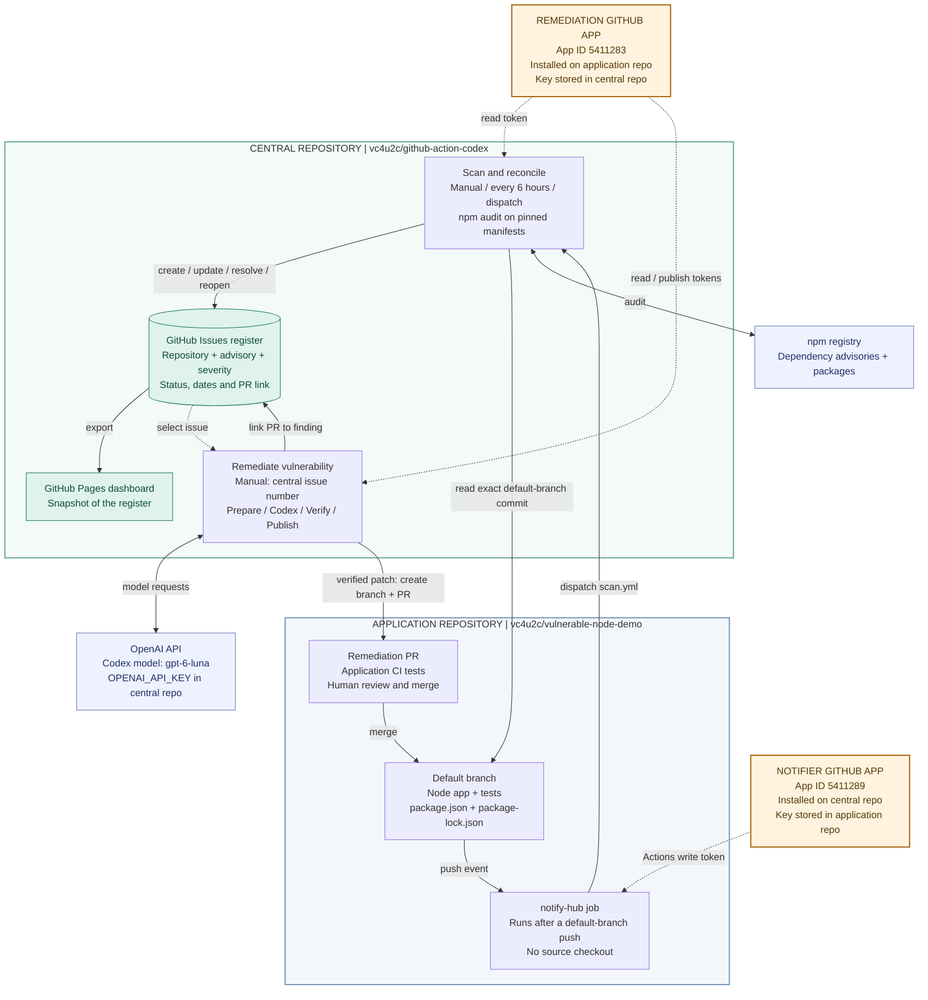
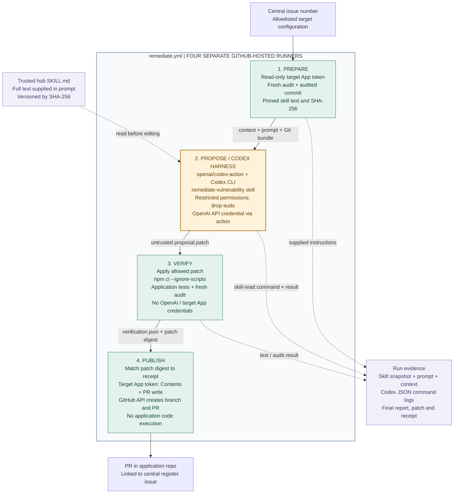

# Vulnerability hub architecture

The central repository owns scanning, the GitHub Issues register, the dashboard, and remediation orchestration. The application repository owns its code, tests, and pull requests. Two GitHub Apps grant access in opposite directions.

[Central repository](https://github.com/vc4u2c/github-action-codex) | [Application repository](https://github.com/vc4u2c/vulnerable-node-demo) | [Live dashboard](https://vc4u2c.github.io/github-action-codex/)

## System overview

Solid arrows show data flow or workflow actions. Dotted arrows show authentication or selection. The diagrams describe the configured flow; they do not indicate that every stage has completed successfully.



[Download PNG](diagrams/architecture.png) | [Open SVG](diagrams/architecture.svg) | [Edit Mermaid source](diagrams/architecture.mmd)

### The two GitHub Apps

App IDs below match the repository variables checked on October 28, 2026. Permissions describe the intended installation grants and the token requests in the workflows. Private keys are stored only as GitHub Actions secrets.

| Identity | Installed on | Private key stored in | Repository permissions | Used by |
| --- | --- | --- | --- | --- |
| **Remediation App**, ID **5411283** (`HUB_APP_ID`) | `vc4u2c/vulnerable-node-demo` | Hub: `HUB_APP_PRIVATE_KEY` | Contents: read/write; Pull requests: read/write; Metadata: read | Hub scanner, remediation prepare/publish, and demo reset |
| **Notifier App**, ID **5411289** (`NOTIFIER_APP_ID`) | `vc4u2c/github-action-codex` | Application: `NOTIFIER_APP_PRIVATE_KEY` | Actions: read/write; Contents: read; Metadata: read | Application `notify-hub` job dispatching the central scan |

Each workflow uses `actions/create-github-app-token` to exchange the App ID and private key for a temporary installation token. Scan and prepare request read-only target access. Publish and reset request Contents/Pull requests write access. The target's notifier credential provides access to the hub; it cannot write application code. Its job runs separately from application tests and performs no source checkout.

The hub's built-in **`GITHUB_TOKEN`** maintains central issues and dispatches follow-up scans. It is separate from the two custom Apps. Pages deployment uses the workflow's **`pages: write`** and **`id-token: write`** permissions. The human's GitHub CLI login is used for setup and manual dispatch, not as a stored runtime credential.

## Where Codex runs

Codex runs in **`remediate.yml` > `propose`**, on a disposable GitHub-hosted Ubuntu 24.04 runner. The hub's workflow and scripts form the harness. The Codex Action invokes the pinned Codex CLI against an exported copy of the audited application commit.



[Download PNG](diagrams/remediation-harness.png) | [Open SVG](diagrams/remediation-harness.svg) | [Edit Mermaid source](diagrams/remediation-harness.mmd)

| Stage | Input and behavior | Credential boundary | Output |
| --- | --- | --- | --- |
| **Prepare** | Validate the issue and target allowlist; fresh audit; reuse an existing open PR when applicable | Read-only target App token; hub token for register/dispatch | Audited Git bundle, normalized context, prompt, skill text and SHA-256 |
| **Propose** | Run `openai/codex-action` with the `remediate-vulnerability` skill | `OPENAI_API_KEY` supplied through the action; no target App private key or target write token | Untrusted patch; Codex command logs and final report |
| **Verify** | Fresh checkout; allowlisted patch; install with lifecycle scripts disabled; tests and fresh audit | No OpenAI or target App credentials; checkout uses the hub's read token | Receipt binding the passing result to the exact patch SHA-256 |
| **Publish** | Fresh checkout; validate patch and receipt; use GitHub's Git/PR APIs | Target App token with Contents/Pull requests write; hub token for register/dispatch | Target branch and PR, linked central finding, requested scan |

The configured model is **`gpt-6-luna`**, selected through the hub's `CODEX_MODEL` variable. Model requests use OpenAI API billing. The skill lives at [`.agents/skills/remediate-vulnerability/SKILL.md`](../.agents/skills/remediate-vulnerability/SKILL.md); the permission profile is [`config/codex.toml`](../config/codex.toml). Target code and advisory descriptions are untrusted input. The independent verifier rejects unsupported file changes, removal of existing tests, an unfixed selected finding, or new advisory identities.

The prompt includes the full skill and requests a skill-read command before edits. Inspect the completed `read-remediation-skill.mjs` command event and its `SKILL_READ` output in the Codex logs. The prepare job's `SKILL_CONFIGURED` message and preserved skill snapshot prove which instructions were supplied; they do not by themselves prove that Codex executed them. See [skill logging in the runbook](demo-runbook.md#show-the-skill-in-the-run-logs).

## Scan, merge, and resolution

1. **Discover:** a manual run, the six-hour schedule, or a notification starts `scan.yml`. It reads `config/targets.json` and fetches both npm manifests at one exact default-branch commit. The scanner runs `npm audit --json` without installing or executing application code.
2. **Register:** one issue identifies each repository + lockfile path + package + advisory. The issue stores severity, status, first/last seen, scan commit, resolution date, and a remediation PR link. GitHub Issues is the source of truth; JSON exports and the Pages dashboard are snapshots.
3. **Remediate:** a maintainer manually starts `remediate.yml` with a central issue number. The four jobs above produce a target PR only if independent verification passes.
4. **Merge:** a human reviews and merges the PR. Application CI tests PRs and default-branch pushes. A separate notifier job requests a hub scan after the default-branch push, even if application tests failed.
5. **Resolve:** the central scanner audits the new default branch. It closes a finding only when a successful scan confirms the advisory is absent. A merge event alone never closes it. Scan failures preserve prior findings; a later recurrence reopens the same issue.

Typical states are **open > pr-open > resolved**. A merged PR awaiting a successful scan may show **awaiting-verification**. A closed, unmerged PR or a merged fix that still leaves the advisory present returns the finding to **open**.

## Repeatable demo and additional targets

The separate **`reset-demo.yml`** workflow uses the Remediation App's target write token to open a reset PR. It restores the explicitly pinned vulnerable baseline's manifests, source and tests, preserving workflow files and history. It makes no OpenAI call. After human merge, the notifier/scan loop reopens recurring findings in the existing register entries. Ordinary targets without `demo.baselineCommit` cannot be reset.

All register-writing hub workflows share one concurrency group. More npm repositories can be added to [`config/targets.json`](../config/targets.json) and the Remediation App installation. The current implementation supports one installation owner. Scanning cloud resources, containers, or other ecosystems requires additional scanner adapters; it is not implemented by this npm demo.

## Implementation map

| Component | Source |
| --- | --- |
| Scanner and Pages deployment | [`scan.yml`](../.github/workflows/scan.yml), [`scripts/scan.mjs`](../scripts/scan.mjs) |
| Finding identity and audit | [`lib/audit.mjs`](../lib/audit.mjs) |
| Register and lifecycle | [`lib/register.mjs`](../lib/register.mjs) |
| Codex harness | [`remediate.yml`](../.github/workflows/remediate.yml), [`prepare-remediation.mjs`](../scripts/prepare-remediation.mjs), [`verify-remediation.mjs`](../scripts/verify-remediation.mjs), [`publish-remediation.mjs`](../scripts/publish-remediation.mjs) |
| Demo reset | [`reset-demo.yml`](../.github/workflows/reset-demo.yml), [`lib/demo-reset.mjs`](../lib/demo-reset.mjs) |
| Application tests and notifier | [Application `ci.yml`](https://github.com/vc4u2c/vulnerable-node-demo/blob/main/.github/workflows/ci.yml) |
| Installation and credential setup | [`setup.md`](setup.md) |

As of October 28, 2026 (America/Chicago), the [Luna remediation run succeeded](https://github.com/vc4u2c/github-action-codex/actions/runs/40803030409) and created [application PR #1](https://github.com/vc4u2c/vulnerable-node-demo/pull/1), updating minimist from 1.2.5 to 1.2.8. The logs contain a completed skill-read command and matching `SKILL_READ` SHA-256. Independent verification passed both application tests and the advisory checks; application PR CI also passed. The register and dashboard show `pr-open`. Human merge and the subsequent scan are still required to demonstrate automatic closure. Five existing lodash advisories remain in the proposed tree.

## Updating the diagrams

The Mermaid blocks above render directly on GitHub. Keep them in sync with the `.mmd` sources in [`diagrams/`](diagrams/). SVG and PNG exports are optional; regenerate them with Mermaid CLI 12.0.0 when needed. The shared [`mermaid-config.json`](diagrams/mermaid-config.json) preserves the layout and colors. From the repository root:

```sh
npx --yes --package @mermaid-js/mermaid-cli@12.0.0 mmdc -i docs/diagrams/architecture.mmd -o docs/diagrams/architecture.svg -c docs/diagrams/mermaid-config.json --no-font-embed -b white --size 2400
```

Repeat for `remediation-harness.mmd`; change the output extension to `.png` and omit `--no-font-embed` for the raster exports. A local browser can be selected with Mermaid CLI's `--puppeteerConfigFile` option.
