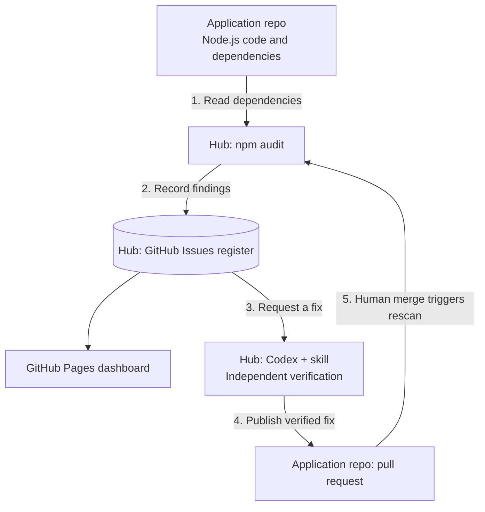
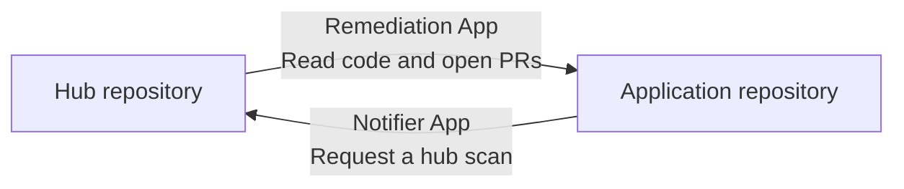

# Architecture

[Setup](setup.md) | [Implementation details](implementation-guide.md) | [Demo runbook](demo-runbook.md)

The hub manages vulnerabilities across application repositories. This demo connects one hub to one small Node.js application.

## Two repositories

| Repository | Owns |
| --- | --- |
| **Hub:** [github-action-codex](https://github.com/vc4u2c/github-action-codex) | Scanner, GitHub Issues register, dashboard, Codex workflow, and remediation skill |
| **Application:** [vulnerable-node-demo](https://github.com/vc4u2c/vulnerable-node-demo) | Application code, dependency files, tests, and fix PRs |

## The main flow

1. The hub scans the application's default branch using `npm audit`.
2. It creates or updates a GitHub issue for each advisory and refreshes the dashboard.
3. A maintainer clicks **Request fix** on the dashboard, then uses GitHub's **Run workflow** button with the displayed register issue number. GitHub checks write access before starting remediation. The issue checkbox is an alternative trigger. Codex uses the skill to propose a change; a separate job tests and audits it.
4. The publish job opens a PR in the application repository.
5. A human reviews and merges it. The application's notifier requests another hub scan.

**The scanner closes the issue only after confirming the advisory is absent.** Scan failures preserve previous findings. If the vulnerability returns, the same issue reopens.

## Why there are two GitHub Apps

| App | Installed on | Private key stored in | Purpose |
| --- | --- | --- | --- |
| **Remediation App** | Application repo | Hub repo | Let the hub read application code and publish fix/reset PRs |
| **Notifier App** | Hub repo | Application repo | Let the application request a new scan after a merge/default-branch push |

The installation is on the repository the App needs to access. Its key is stored in the repository whose workflow uses it. [Setup](setup.md#3-create-the-remediation-app) lists the exact permissions and secret names.

The hub's built-in `GITHUB_TOKEN` updates its own issues. Pages deployment uses the workflow's Pages permissions. Neither requires a third custom App.

## Where Codex and the dashboard run

Codex runs in the hub's `remediate.yml` workflow on a temporary GitHub-hosted Ubuntu runner. It reads the trusted `remediate-vulnerability` skill and calls the OpenAI API using the hub's `OPENAI_API_KEY`. Verification and PR publication run in separate jobs.

The dashboard is a static GitHub Pages site displaying the latest register snapshot. The authoritative records are GitHub Issues; there is no separate database or always-running backend in this demo.

## Repeat the demo

After a fix is merged, run **Reset demo** and merge its reset PR. It restores the pinned vulnerable application baseline. The notifier requests a scan and the existing finding reopens. Reset makes no OpenAI call.

For the exact jobs, source files, credentials, and completed example, continue to the [implementation guide](implementation-guide.md). Diagram sources: [main flow](diagrams/architecture.mmd), [GitHub Apps](diagrams/github-apps.mmd).
