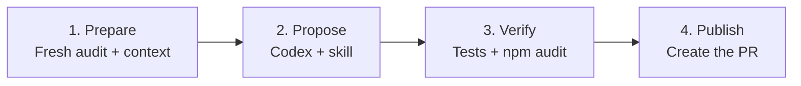

# Implementation guide

[Architecture](architecture.md) | [Setup](setup.md) | [Demo runbook](demo-runbook.md)

This guide explains what was implemented, the files behind each part, and what has been demonstrated. Use [Setup](setup.md) to reproduce the installation.

## 1. The application and its vulnerable baseline

The [application repository](https://github.com/vc4u2c/vulnerable-node-demo) contains a small Node.js product-catalog API, two behavior tests, and committed npm manifests. It binds to `127.0.0.1`; the demo does not deploy it to a public service.

| File in the application repo | Purpose |
| --- | --- |
| `src/server.mjs` | HTTP API: `/health` and `/api/products`; uses minimist for command-line arguments |
| `src/catalog.mjs` | Product filtering and sorting; uses lodash |
| `test/app.test.mjs` | Tests catalog behavior and the HTTP endpoints |
| `package.json`, `package-lock.json` | Deliberately pin lodash 4.17.20 and minimist 1.2.5 in the baseline |
| `.github/workflows/ci.yml` | Tests PRs/pushes; separately notifies the hub after a default-branch push |

The vulnerable baseline is commit `173e2720f075cb0a232b784c82ee4bb123da5fbb`. Reset restores application files from that commit. Keeping the application's Git history when copying the demo preserves this reset capability.

## 2. The hub's target configuration

[`config/targets.json`](../config/targets.json) identifies the repositories and package directories the hub is allowed to scan and remediate:

```json
{
  "targets": [
    {
      "id": "node-demo",
      "repository": "vc4u2c/vulnerable-node-demo",
      "directory": ".",
      "ecosystem": "npm",
      "demo": {
        "baselineCommit": "173e2720f075cb0a232b784c82ee4bb123da5fbb"
      }
    }
  ]
}
```

`directory` must contain both npm manifests. The optional `demo` section enables reset for that target. Ordinary targets can omit it. [`scripts/configure.mjs`](../scripts/configure.mjs) changes the first target's owner while retaining the `vulnerable-node-demo` repository name; it does not create repositories or configure credentials.

## 3. Scanning and the vulnerability register

[`scan.yml`](../.github/workflows/scan.yml) runs manually, approximately every six hours, or when another workflow requests it. [`scripts/scan.mjs`](../scripts/scan.mjs) coordinates these steps:

1. Read each target's default-branch commit and fetch `package.json` and `package-lock.json` at that exact commit.
2. Run `npm audit --json` against those manifests in a temporary directory. The scanner does not install or execute application code.
3. Normalize the npm report into individual advisories, preserving severity and affected package information.
4. Confirm the default branch has not moved during the scan, then reconcile the findings with central GitHub Issues.
5. Export the register, raw audit evidence, Actions summary, and dashboard.

[`lib/audit.mjs`](../lib/audit.mjs) handles scanning and finding identity. [`lib/register.mjs`](../lib/register.mjs) handles issue storage and lifecycle. An identity is based on **repository + lockfile path + package + advisory ID**; changing a dependency version does not create a new identity.

Each issue has the `vulnerability-register` label, a readable table, and a hidden structured record. It stores severity, repository, installed version, dates, scanned commit, status, and PR link. Put human notes in comments; the scanner owns the issue body.

| State | Meaning |
| --- | --- |
| `open` | The advisory is present and has no open remediation PR |
| `pr-open` | A proposed fix is under review |
| `awaiting-verification` | A PR was merged but there is no successful scan confirming resolution yet |
| `resolved` | A successful scan confirmed the advisory is absent; the issue is closed |

Closing a PR without merging does not resolve its finding. A merged PR that leaves the advisory present returns to `open`. A later recurrence reopens the same issue. Malformed reports, registry errors, or default-branch movement cannot produce a clean scan; prior findings remain. The register reads closed issues too, preserving history across demo resets.

## 4. The dashboard

[`lib/dashboard.mjs`](../lib/dashboard.mjs) combines the register snapshot with the static files in [`dashboard/`](../dashboard/). The scan uploads `artifacts/` and `site/` as the **vulnerability-dashboard** artifact. When `PUBLISH_DASHBOARD=true`, its Pages job publishes `site/`.

GitHub Issues is the source of truth. `site/register.json` and the dashboard are snapshots with a generation timestamp. There is no separate database. Local rehearsal instead persists its register in `artifacts/local-register.json`.

## 5. The Codex harness and remediation skill

The harness is the workflow plus the scripts that prepare input, run Codex, verify its output, and publish the PR. It runs entirely in GitHub Actions. A maintainer supplies a central issue number to [`remediate.yml`](../.github/workflows/remediate.yml).



Each stage uses a separate runner:

| Job | What was implemented | Access and output |
| --- | --- | --- |
| **Prepare** | Validate the issue against the target configuration, audit again, and reuse an existing open remediation PR when present | Read-only application App token. Produces an audited Git bundle, context, prompt, and skill snapshot |
| **Propose** | Restore that exact commit and run `openai/codex-action` with the remediation skill | OpenAI API credential through the Action; no target App key/write token. Produces an untrusted patch and Codex report |
| **Verify** | Apply and audit the patch on a fresh runner, then install dependencies and run tests in restricted containers | No OpenAI or target App credentials. Produces a receipt tied to the patch SHA-256 and records the verification image |
| **Publish** | Check the receipt and patch digest, then create the commit, branch, and PR using GitHub APIs | Application App token with Contents/PR write. Links the PR to the register and requests a scan; executes no application code |

The implementation lives in [`prepare-remediation.mjs`](../scripts/prepare-remediation.mjs), [`verify-remediation.mjs`](../scripts/verify-remediation.mjs), [`publish-remediation.mjs`](../scripts/publish-remediation.mjs), and [`lib/remediation.mjs`](../lib/remediation.mjs).

The trusted skill is [`.agents/skills/remediate-vulnerability/SKILL.md`](../.agents/skills/remediate-vulnerability/SKILL.md). It directs Codex to make a focused dependency update, preserve registry lockfile integrity, test the result, and report remaining findings. The prompt includes the full skill and requests that Codex read it before editing.

The verifier permits dependency-related `package.json` changes, `package-lock.json`, and `.mjs` files under `src/` and `test/`. It rejects changes to workflows/instructions, unsafe file modes, removed test files, an unfixed selected advisory, and new advisory identities. Existing unrelated findings may remain. Human review is still needed for the actual source diff.

[`lib/verification-sandbox.mjs`](../lib/verification-sandbox.mjs) isolates application execution from the verifier. The host audits the pristine patch before executing application code. A non-root installer copies the target into a disposable Docker volume and runs `npm ci --ignore-scripts`. Tests run in a separate non-root container with that volume read-only, no external network, and writable temporary storage. Loopback remains available for HTTP tests. Neither container receives runner credentials, the Docker socket, the hub, context, patch, or receipt. Installation has network access for package downloads. The image is pinned by digest in `config/tool-versions.json`; resource limits and timeouts bound execution. An all-skipped test run is rejected.

This isolation was added after the first successful live remediation. The [adversarial review](adversarial-review.md) records the reproduced gaps, fixes, validation, and remaining limits.

The current model variable is `CODEX_MODEL=gpt-6-luna`; the CLI is pinned to `0.163.0`. The [permission profile](../config/codex.toml) restricts filesystem/network access, and the Action uses `drop-sudo`. All four remediation jobs use `ubuntu-24.04`. The pinned Action failed its system-socket protection check on Ubuntu 26.04 in [this run](https://github.com/vc4u2c/github-action-codex/actions/runs/40802770824); pinning the OS allowed the existing protection to complete.

### How to verify skill use

In **propose > Run Codex with the remediation skill**, find the completed `read-remediation-skill.mjs` command with exit code 0 and its `SKILL_READ name=remediate-vulnerability sha256=...` output. Compare that hash with prepare's `SKILL_CONFIGURED` output. A skill name appearing in the prompt alone is not execution evidence.

| Evidence | Where to find it |
| --- | --- |
| Exact instructions, skill hash, target commit, and finding | `remediation-context` artifact |
| Actual commands, output, and token usage | Codex JSON events in the propose job log |
| Codex's summary and limitations | `codex-report` artifact |
| Proposed changes | `remediation-proposal` artifact |
| Independent verification and patch digest | `remediation-verification` artifact |

For Action behavior and authentication, see the [official OpenAI documentation](https://learn.chatgpt.com/docs/github-action). The [diagram source](diagrams/remediation-harness.mmd) matches the Mermaid block above.

## 6. GitHub Apps and merge verification

The App credentials connect the two repositories. These are the configured demo identities, not values to copy into a new installation:

| Identity | Configured value | Installed on | Secret stored in | Repository permissions |
| --- | --- | --- | --- | --- |
| Remediation App | `HUB_APP_ID=5411283` | Application | Hub: `HUB_APP_PRIVATE_KEY` | Contents read/write; Pull requests read/write; Metadata read |
| Notifier App | `NOTIFIER_APP_ID=5411289` | Hub | Application: `NOTIFIER_APP_PRIVATE_KEY` | Actions read/write; Contents read; Metadata read |

`actions/create-github-app-token` creates temporary installation tokens. Scan/prepare request read-only target permissions; publish/reset request write permissions. The hub's built-in `GITHUB_TOKEN` updates central issues and requests follow-up scans. Pages deployment uses `pages: write` and `id-token: write`.

After a default-branch push, the application's separate `notify-hub` job requests `scan.yml` in the hub. It runs even if application tests fail and performs no source checkout. PR events do not run this notifier job. The application stores `HUB_REPOSITORY=vc4u2c/github-action-codex` to identify the hub.

A successful rescan closes the selected issue only if the advisory is absent. If the notifier is omitted, manual and scheduled scans still reconcile findings. [Setup](setup.md) shows how to create both Apps and store the credentials.

## 7. Repeatable reset and local rehearsal

[`reset-demo.yml`](../.github/workflows/reset-demo.yml), [`scripts/reset-demo.mjs`](../scripts/reset-demo.mjs), and [`lib/demo-reset.mjs`](../lib/demo-reset.mjs) create a PR restoring the configured baseline's manifests, `src/`, and `test/`. Added source/test files are removed by the reset patch; workflows, documentation, Git history, and issue history are preserved.

Reset is available only for explicit demo targets. It reuses an open reset PR and blocks when a remediation PR is still open. After human merge, the normal notifier/scan loop reopens recurring findings. Reset does not call OpenAI.

Local `demo:reset` and `demo:fix` use [`local-demo-cycle.mjs`](../scripts/local-demo-cycle.mjs) in `.work/demo-target`. The local fix is scripted; it rehearses the lifecycle without calling Codex. [`verify-demo.mjs`](../scripts/verify-demo.mjs) exercises the real patch verifier in an isolated workspace. See the [runbook](demo-runbook.md) for commands.

## 8. What has been demonstrated

Snapshot as of **October 28, 2026 (America/Chicago)**:

| Capability | Evidence |
| --- | --- |
| Scanning, register updates, and Pages publication | [Successful scan](https://github.com/vc4u2c/github-action-codex/actions/runs/40803240896), [dashboard](https://vc4u2c.github.io/github-action-codex/) |
| Luna remediation through all four jobs | [Successful run 40803030409](https://github.com/vc4u2c/github-action-codex/actions/runs/40803030409) |
| Actual skill read | [Propose log](https://github.com/vc4u2c/github-action-codex/actions/runs/40803030409/job/123215431165): completed read command and matching `SKILL_READ` hash |
| Verified fix | [Application PR #1](https://github.com/vc4u2c/vulnerable-node-demo/pull/1): minimist 1.2.5 to 1.2.8, two manifest files changed |
| Independent tests and advisory checks | [Verifier log](https://github.com/vc4u2c/github-action-codex/actions/runs/40803030409/job/123215869300): two tests pass, selected advisory absent, no new advisory identities |
| Application PR CI | [Passing check](https://github.com/vc4u2c/vulnerable-node-demo/actions/runs/40803240449) |
| Merge, automatic closure, and live reset cycle | Still pending for this PR; [issue #6](https://github.com/vc4u2c/github-action-codex/issues/6) and the dashboard show `pr-open` |

Five existing lodash advisories remain in the proposed tree. Codex's report records two HTTP-test socket failures in the propose environment; the independent verifier and application CI passed those unchanged tests. The report and verification receipt preserve both results.

The hub also has tests for finding recurrence, failed scans, duplicate detection, issue pagination, target isolation, skill evidence, reset behavior, real Git patch rejection, and all-skipped test rejection. Run them with `npm test`. Hub CI additionally runs Docker isolation tests that attempt to alter audit inputs and access host evidence/credentials. The Docker tests are opt-in locally; see the [review validation commands](adversarial-review.md#repeat-the-checks).

## Supported scope and extension points

| Requirement | Current implementation / next change |
| --- | --- |
| More npm repositories | Add entries to `config/targets.json` and the Remediation App installation |
| Multiple GitHub owners | Requires separate installation-token handling; current workflows use one owner |
| React or another test framework | Adapt the verifier and allowed file types; the current contract uses `.mjs` and Node's test runner |
| Private registries | Add explicit registry credentials and network policy; the current audit uses the public npm registry |
| SAST, secrets, containers, or cloud resources | Add scanner adapters, finding identities, and evidence/verification rules |
| Larger fleet | Add a durable queue, storage, and finer-grained locking; current register writers share one concurrency group |

The shared concurrency group prevents concurrent register writes, but GitHub may replace an older pending run with a newer one. Scheduled reconciliation provides recovery for this demo; it is not a durable job queue.

The verification contract currently requires Linux containers and tests that write scratch files under the system temporary directory. Tests cannot write the application checkout or contact external services. GitHub-hosted remediation runners provide Docker; local `verify-demo.mjs` requires a running Docker engine with Linux containers. The ordinary dashboard rehearsal does not require Docker.

Tool versions are recorded in [`config/tool-versions.json`](../config/tool-versions.json). [`scripts/pin-actions.mjs`](../scripts/pin-actions.mjs) deliberately refreshes Action commit pins and the Codex CLI version; review and validate those changes when upgrading, rather than running it during routine setup. That script preserves the verification image pin; update and validate the image digest separately.
